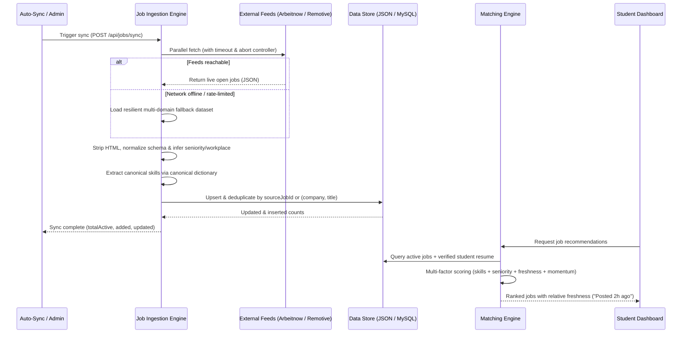
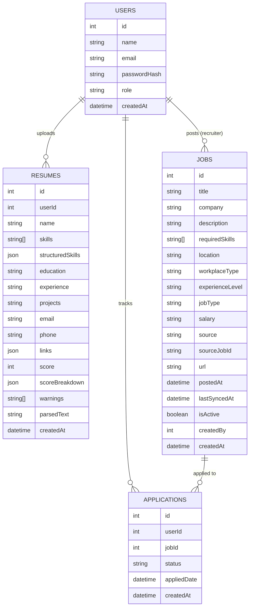

# CareerAI Architecture (V6 Real-Time Placement Intelligence)

## System Overview

```mermaid
flowchart TB
    User((Student / Recruiter))
    User --> FE[React Frontend<br/>Vite + React Router + Recharts]
    FE -->|REST, JWT| API[Express API Layer]

    subgraph External Sources
        Arbeitnow[Arbeitnow Public Feed]
        Remotive[Remotive Remote Jobs API]
        Direct[Employer Direct Postings]
    end

    subgraph Ingestion & Freshness
        Ingester[Job Ingestion Engine<br/>stripHtml + dedupe + normalize]
        Ingester -->|Auto-tag| SkillExtract
    end

    External Sources --> Ingester

    subgraph API Layer
        Auth[Auth routes<br/>JWT + bcrypt]
        Resumes[Resume routes<br/>upload + parse]
        Jobs[Job routes<br/>search + filter + sync]
        Matching[Matching routes<br/>recommendations + skill-gap]
        Applications[Application routes]
        Dashboard[Dashboard routes]
        Assistant[AI Assistant routes<br/>daily-plan + chat]
    end

    API --> Auth
    API --> Resumes
    API --> Jobs
    API --> Matching
    API --> Applications
    API --> Dashboard
    API --> Assistant

    Resumes --> Parser[Resume Parser<br/>pdf-parse / mammoth]
    Parser --> SkillExtract[Skill Extractor<br/>canonical dictionary + aliases]
    Matching --> MatchEngine[Multi-Factor Match Engine<br/>skills, seniority, freshness, semantic]
    Matching --> GapEngine[Skill Gap + Market Velocity Trends]
    Matching -.->|Optional Semantic Embeddings| PythonNLP[Python NLP Service<br/>sentence-transformers all-MiniLM-L6-v2]

    Ingester --> DB[(Data Store: JSON / MySQL)]
    Auth --> DB
    Resumes --> DB
    Jobs --> DB
    Applications --> DB
    Dashboard --> DB
```

## Real-Time Job Ingestion & Synchronization Pipeline



## Data Model



## Architecture Decisions & Component Status

| Component | Implementation in V6 | Design Rationale |
|---|---|---|
| **Real-Time Job Ingestion** | **Multi-source automated engine (`backend/utils/jobIngestion.js`)** connecting to **Arbeitnow** & **Remotive** open feeds with offline fallback | Solves the static seeded dataset limitation without requiring paid API keys. Normalizes descriptions, infers workplace types (Remote/Hybrid/On-site), seniority levels, and posting timestamps. |
| **Job Freshness & Velocity** | **Timestamp tracking (`postedAt`, `lastSyncedAt`, `isActive`)** + Relative Time UI ("Posted 2h ago") | Replaces static demo listings with verifiable freshness signals. Ingestion engine deduplicates postings and updates active statuses automatically. |
| **Multi-Factor Matching Engine** | **Weighted scoring (Skill 40%, Experience 15%, Seniority 10%, Education 10%, Projects 10%, Freshness Momentum 10%, Keywords 5%)** + optional Semantic Embeddings | Explainable matching that takes into account hiring momentum (recent postings receive priority) and candidate seniority fit alongside technical skills. |
| **Semantic Similarity (NLP Service)** | **Real Transformer Sentence Embeddings (`all-MiniLM-L6-v2`) via `python-ai/main.py`** with graceful fallback | Evaluates deep contextual meaning beyond keyword matching. If the service is running, it contributes 25% hybrid weight; if offline, Node matching engine scores deterministically without downtime. |
| **Dynamic Skill Demand & Trends** | **Market-wide analytics (`computeSkillDemand`)** computing 30-day demand velocity (`↑ 18% this month`) across live listings | Feeds real employer demand into the skill-gap priority ranker and Dashboard meters instead of relying on a static whitelist. |
| **Actionable AI Career Assistant** | **Deterministic Daily Application Plan (`/api/assistant/daily-plan`)** + Claude Generative Chat grounded in live jobs | Answers "Which jobs should I apply to today?" with direct ranked targets, verified skill coverage ratios, and customized cover bullet pitch tips. |
| **C++ Ranking Engine** | **Persistent process ranker (`ranking-engine/ranker`)** gated by `ENABLE_CPP_RANKER=false` | Built and correctness-tested for large candidate pools. Gated off by default because benchmarked V2 IPC serialization is outpaced by V8 native operations on moderate candidate sizes. |
| **Database Abstraction** | **Dual-driver architecture (`db-json.js` and `db-mysql.js`)** | Zero-setup JSON database for instant local development; production-ready MySQL/MariaDB driver with connection pooling and schema migrations via `DB_DRIVER=mysql`. |
